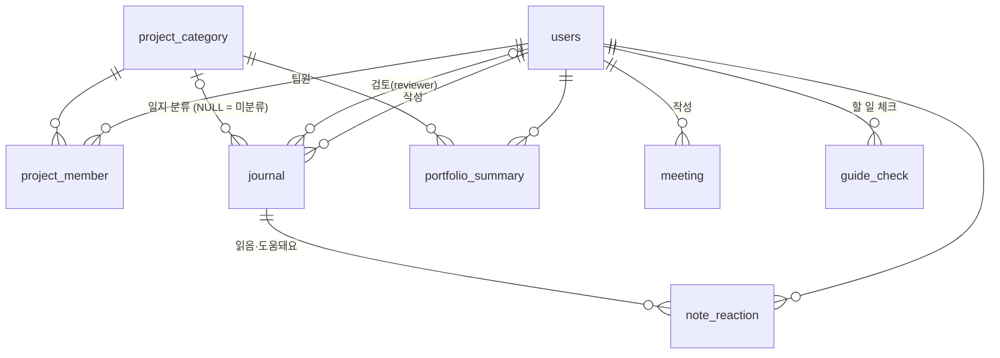

# ERD (확정)

ERDCloud 최종본(2026-11-11 확정) 기준이에요. 엔티티를 바꾸면 이 문서도 같이 고쳐 주세요.

- 테이블 10개: `users`, `project_category`, `project_member`, `invite_code`, `events`, `guide_check`, `meeting`, `journal`, `note_reaction`, `portfolio_summary`
- 모든 테이블에 `created_at`, `updated_at`이 있어요 (`portfolio_summary`는 `created_at`만)

## 관계



`invite_code`, `events`는 다른 테이블과 FK 없음.

## SQL (MySQL)

```sql
CREATE TABLE `users` (
    `id`          BIGINT       NOT NULL AUTO_INCREMENT,
    `email`       VARCHAR(255) NOT NULL,
    `google_sub`  VARCHAR(255) NOT NULL,
    `name`        VARCHAR(30)  NOT NULL,
    `type`        VARCHAR(10)  NOT NULL COMMENT 'MEMBER | ADMIN',
    `cohort`      INT          NOT NULL,
    `part`        VARCHAR(20)  NULL     COMMENT '기본 파트, 운영진이 지정. PM | DESIGN | FRONTEND | BACKEND | OPS(운영진 가입 시). NULL = 배정 전. 프로젝트별 실제 파트는 project_member.part',
    `created_at`  DATETIME(6)  NULL,
    `updated_at`  DATETIME(6)  NULL,
    PRIMARY KEY (`id`),
    UNIQUE KEY `UK_USERS_EMAIL` (`email`),
    UNIQUE KEY `UK_USERS_GOOGLE_SUB` (`google_sub`)
);

CREATE TABLE `project_category` (
    `id`          BIGINT       NOT NULL AUTO_INCREMENT,
    `title`       VARCHAR(60)  NOT NULL,
    `kind`        VARCHAR(10)  NOT NULL COMMENT 'TEAM(아기사자 팀) | OPERATION(운영)',
    `cohort`      INT          NOT NULL,
    `anon_label`  VARCHAR(10)  NULL     COMMENT '다음 기수에게 보이는 팀 가명(예: B팀). 분류 생성 시 시스템이 A, B, C… 자동 부여',
    `created_at`  DATETIME(6)  NULL,
    `updated_at`  DATETIME(6)  NULL,
    PRIMARY KEY (`id`)
);

CREATE TABLE `project_member` (
    `id`          BIGINT       NOT NULL AUTO_INCREMENT,
    `user_id`     BIGINT       NOT NULL,
    `project_id`  BIGINT       NOT NULL,
    `part`        VARCHAR(20)  NULL     COMMENT '이 프로젝트에서의 파트. 배정 시 users.part를 복사하고, 다를 때만 운영진이 수정. 운영 분류는 NULL',
    `is_current`  BOOLEAN      NOT NULL DEFAULT true COMMENT '현재 배정 여부. 재배정 시 기존 행은 false로 남김(삭제 금지)',
    `created_at`  DATETIME(6)  NULL,
    `updated_at`  DATETIME(6)  NULL,
    PRIMARY KEY (`id`),
    UNIQUE KEY `UK_PROJECT_MEMBER` (`user_id`, `project_id`)
);

CREATE TABLE `invite_code` (
    `id`          BIGINT       NOT NULL AUTO_INCREMENT,
    `code`        VARCHAR(6)   NOT NULL,
    `user_type`   VARCHAR(10)  NOT NULL COMMENT 'MEMBER | ADMIN',
    `cohort`      INT          NOT NULL,
    `enabled`     BOOLEAN      NOT NULL,
    `expires_at`  DATE         NULL     COMMENT '만료일. NULL = 만료 없음',
    `created_at`  DATETIME(6)  NULL,
    `updated_at`  DATETIME(6)  NULL,
    PRIMARY KEY (`id`),
    UNIQUE KEY `UK_INVITE_CODE_CODE` (`code`)
);

CREATE TABLE `events` (
    `id`          BIGINT       NOT NULL AUTO_INCREMENT,
    `cohort`      INT          NOT NULL,
    `name`        VARCHAR(60)  NOT NULL,
    `type`        VARCHAR(20)  NOT NULL COMMENT 'KICKOFF(주차 계산 기준) | MAJOR(D-day 대상 큰 행사) | REGULAR(정기 세션)',
    `event_date`  DATE         NOT NULL,
    `created_at`  DATETIME(6)  NULL,
    `updated_at`  DATETIME(6)  NULL,
    PRIMARY KEY (`id`)
);

CREATE TABLE `guide_check` (
    `id`          BIGINT       NOT NULL AUTO_INCREMENT,
    `user_id`     BIGINT       NOT NULL,
    `item_key`    VARCHAR(40)  NOT NULL COMMENT '"{기수}-{주차}-{항목}" (예: 14-w2-collect-time). 운영진 한마디 도움돼요는 "tip-{기수}-{주차}"',
    `created_at`  DATETIME(6)  NULL,
    `updated_at`  DATETIME(6)  NULL,
    PRIMARY KEY (`id`),
    UNIQUE KEY `UK_GUIDE_CHECK` (`user_id`, `item_key`)
);

CREATE TABLE `meeting` (
    `id`            BIGINT       NOT NULL AUTO_INCREMENT,
    `owner_id`      BIGINT       NOT NULL,
    `type`          VARCHAR(10)  NOT NULL COMMENT 'FIRST | IDEA | MIDCHECK | RETRO',
    `meeting_date`  DATE         NOT NULL,
    `decisions`     TEXT         NULL     COMMENT '정한 것, 한 줄에 하나',
    `actions`       TEXT         NULL     COMMENT '누가·무엇·언제까지 (JSON 배열 문자열)',
    `created_at`    DATETIME(6)  NULL,
    `updated_at`    DATETIME(6)  NULL,
    PRIMARY KEY (`id`)
);

CREATE TABLE `journal` (
    `id`             BIGINT       NOT NULL AUTO_INCREMENT,
    `author_id`      BIGINT       NOT NULL,
    `project_id`     BIGINT       NULL     COMMENT 'NULL = 미분류',
    `part`           VARCHAR(20)  NULL     COMMENT '이때 내 파트. 작성 시 현재 project_member.part가 기본값',
    `activity`       VARCHAR(20)  NULL     COMMENT 'SESSION | IDEATHON | HACKATHON | MIDTERM | DEMODAY | ETC',
    `timing`         VARCHAR(10)  NULL     COMMENT 'W2PLUS | W1_2 | DURING | AFTER',
    `scope`          VARCHAR(10)  NULL     COMMENT 'NOW | NEXT',
    `status`         VARCHAR(10)  NOT NULL COMMENT 'DRAFT | PENDING | REJECTED | APPROVED',
    `raw_stuck`      TEXT         NULL,
    `raw_solved`     TEXT         NULL,
    `raw_again`      TEXT         NULL,
    `raw_memo`       TEXT         NULL,
    `summary_title`  VARCHAR(255) NULL,
    `sum_stuck`      TEXT         NULL,
    `sum_solved`     TEXT         NULL,
    `sum_again`      TEXT         NULL,
    `sum_memo`       TEXT         NULL,
    `tags`           JSON         NULL     COMMENT '태그 12개 목록 중 최대 3개, 문자열 배열',
    `reject_reason`  VARCHAR(200) NULL,
    `reviewer_id`    BIGINT       NULL     COMMENT '검토한 운영진',
    `reviewed_at`    DATETIME(6)  NULL     COMMENT '승인·반려 처리 시각',
    `created_at`     DATETIME(6)  NULL,
    `updated_at`     DATETIME(6)  NULL     COMMENT '검토 대기열 정렬에도 사용',
    PRIMARY KEY (`id`)
);

CREATE TABLE `note_reaction` (
    `id`          BIGINT       NOT NULL AUTO_INCREMENT,
    `user_id`     BIGINT       NOT NULL,
    `journal_id`  BIGINT       NOT NULL,
    `helped`      BOOLEAN      NOT NULL DEFAULT false COMMENT '행이 있으면 읽음, helped = true면 도움돼요',
    `created_at`  DATETIME(6)  NULL,
    `updated_at`  DATETIME(6)  NULL,
    PRIMARY KEY (`id`),
    UNIQUE KEY `UK_NOTE_REACTION` (`user_id`, `journal_id`)
);

CREATE TABLE `portfolio_summary` (
    `id`                  BIGINT       NOT NULL AUTO_INCREMENT,
    `user_id`             BIGINT       NOT NULL,
    `project_id`          BIGINT       NOT NULL,
    `format`              VARCHAR(30)  NOT NULL COMMENT 'RESUME_3LINES | EXPERIENCE_PARAGRAPH',
    `result`              TEXT         NOT NULL,
    `source_journal_ids`  JSON         NOT NULL COMMENT '근거 일지 id 배열',
    `created_at`          DATETIME(6)  NOT NULL COMMENT '하루 5회 제한 계산',
    PRIMARY KEY (`id`)
);

ALTER TABLE `project_member`    ADD CONSTRAINT `FK_PROJECT_MEMBER_USER`       FOREIGN KEY (`user_id`)     REFERENCES `users` (`id`);
ALTER TABLE `project_member`    ADD CONSTRAINT `FK_PROJECT_MEMBER_PROJECT`    FOREIGN KEY (`project_id`)  REFERENCES `project_category` (`id`);
ALTER TABLE `journal`           ADD CONSTRAINT `FK_JOURNAL_AUTHOR`            FOREIGN KEY (`author_id`)   REFERENCES `users` (`id`);
ALTER TABLE `journal`           ADD CONSTRAINT `FK_JOURNAL_REVIEWER`          FOREIGN KEY (`reviewer_id`) REFERENCES `users` (`id`);
ALTER TABLE `journal`           ADD CONSTRAINT `FK_JOURNAL_PROJECT`           FOREIGN KEY (`project_id`)  REFERENCES `project_category` (`id`);
ALTER TABLE `note_reaction`     ADD CONSTRAINT `FK_NOTE_REACTION_USER`        FOREIGN KEY (`user_id`)     REFERENCES `users` (`id`);
ALTER TABLE `note_reaction`     ADD CONSTRAINT `FK_NOTE_REACTION_JOURNAL`     FOREIGN KEY (`journal_id`)  REFERENCES `journal` (`id`);
ALTER TABLE `portfolio_summary` ADD CONSTRAINT `FK_PORTFOLIO_SUMMARY_USER`    FOREIGN KEY (`user_id`)     REFERENCES `users` (`id`);
ALTER TABLE `portfolio_summary` ADD CONSTRAINT `FK_PORTFOLIO_SUMMARY_PROJECT` FOREIGN KEY (`project_id`)  REFERENCES `project_category` (`id`);
ALTER TABLE `meeting`           ADD CONSTRAINT `FK_MEETING_OWNER`             FOREIGN KEY (`owner_id`)    REFERENCES `users` (`id`);
ALTER TABLE `guide_check`       ADD CONSTRAINT `FK_GUIDE_CHECK_USER`          FOREIGN KEY (`user_id`)     REFERENCES `users` (`id`);
```

## 설계하면서 정한 것

- **노트 테이블은 따로 없어요.** 승인된 일지(`status = APPROVED`)의 AI 정리본(`summary_title`, `sum_*`)이 곧 노트예요.
- **원문과 정리본을 한 행에 둬요.** 원문(`raw_*`)은 작성자만, 정리본은 노트 게시판·검토 화면에서 봐요.
- **한 사람이 행사마다 다른 팀에 속해요.** 사람과 프로젝트는 `project_member`로 이어요. 지금 팀은 `is_current = true`인 행이고, 재배정해도 기존 행은 지우지 않고 `false`로 남겨요. 이전 일지는 이전 분류에 그대로 남아요.
- **파트는 두 군데.** `users.part`는 기본 파트, `project_member.part`는 그 프로젝트에서의 파트(배정 때 복사). 일지를 쓸 때 그 값이 `journal.part`의 기본값이 되고, 노트 표시는 `journal.part`를 써요. 프론트·백엔드는 거의 안 바뀌고 PM·디자인은 프로젝트마다 바뀔 수 있어요.
- **같은 팀원 숨김은 그 일지의 팀만 확인해요.** 일지의 `project_id`에 보는 사람이 `project_member`로 들어 있으면(`is_current = false` 행 포함) 숨겨요. 다른 행사에서 같은 팀이었던 건 상관없어요. 미분류 일지는 숨기지 않아요. 작성자 본인은 항상 봐요.
- **팀 가명은 `project_category.anon_label`.** 지난 기수 노트에만 보여요 ("지난 기수 B팀 · PM").
- **읽음·도움돼요는 `note_reaction` 한 테이블이에요.** 노트를 처음 열면 행이 생기고(읽음, 1인 1회, 작성자 제외), 도움돼요를 누르면 `helped`만 바뀌어요. 개수는 매번 세요.
- **보완 질문은 저장하지 않아요.** 처음 정리할 때(`summary_title`이 비어 있을 때)만 만들어서 응답으로 주고, 답은 `raw_solved` 끝에 붙여요.
- **검토 요청 시각 컬럼이 없어요.** 대기열 정렬은 `updated_at` 기준(`PENDING`이면 더 수정 못 해서 요청 시각과 같음).
- **포트폴리오 하루 5회**는 `portfolio_summary`에서 오늘(KST) 만든 개수로 세요.
- **조건으로 검색할 일이 없는 건 컬럼 하나에 담았어요.** 일지 `tags`(JSON), 회의 `decisions`·`actions`(TEXT).
- **가이드 할 일, 회의 도우미 질문·팁은 테이블이 없어요.** `seed/*.json`에서 읽고, 체크 기록만 `guide_check`에 저장해요.
- **`users`, `project_category`, `project_member`는 A가 만들고 B도 써요.** 컬럼 바꿀 땐 서로 알리기.